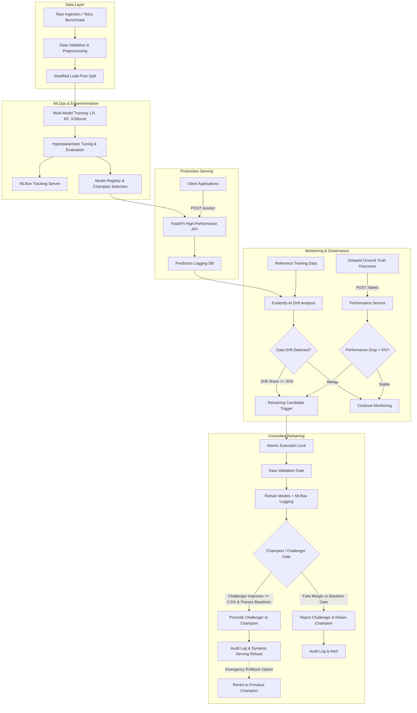

# DriftGuard Architecture Documentation

## 1. System Overview

DriftGuard is an enterprise-grade, end-to-end MLOps platform for Customer Churn Prediction. It bridges continuous model training, experiment tracking, microservice inference, live production monitoring, data drift detection, and controlled automated retraining with champion/challenger governance.

## 2. Component Architecture

### 2.1 Machine Learning Pipeline (`ml/`)
- **`dataset.py`**: Ingests the canonical IBM Telco Customer Churn dataset (7,043 rows) with 19 customer features. Includes fallback offline distribution generators and realistic drift scenario injectors (`gradual_fiber_optic_shift`, `demographic_shift`, `economic_crisis`).
- **`validation.py`**: Performs rigorous schema checks, unexpected categorical value detection, duplicate customer resolution, missing value imputation, and IQR-based outlier analysis.
- **`pipeline.py`**: Leak-free scikit-learn transformers. Implements domain feature engineering (`tenure_years`, `monthly_to_total_ratio`, `total_services_subscribed`, `has_tech_or_security`, `is_high_risk_combo`). Builds a `ColumnTransformer` with `StandardScaler` for numerical features and `OneHotEncoder(handle_unknown='ignore')` for categorical features. Handles class imbalance via balanced sample weighting.
- **`train.py`**: Simultaneously trains and evaluates Logistic Regression, Random Forest, and XGBoost classifiers. Logs runs, hyperparameters, metrics (ROC-AUC, F1, Accuracy, Precision, Recall, PR-AUC, Brier score, Net Financial Benefit), confusion matrices, and ROC/PR curve points to MLflow.
- **`evaluate.py`**: Comprehensive classification metrics calculation and business net benefit estimation based on customer lifetime value ($1,500) and retention incentive cost ($120).
- **`explain.py`**: SHAP feature importance extraction and tree/linear coefficient rankings.
- **`registry.py`**: Local and remote Model Registry manager. Manages version storage, champion promotion, baseline quality gates (ROC-AUC &ge; 0.70, F1 &ge; 0.45), margin improvement gates (&Delta; &ge; 0.005), and instantaneous rollback.

### 2.2 Serving & API Layer (`backend/app/`)
- **FastAPI Core**:
  - `POST /predict`: Single customer churn inference with Pydantic validation and microsecond latency logging.
  - `POST /predict/batch`: High-throughput batch inference.
  - `GET /health`: Health status and active champion version.
  - `GET /model/info` & `GET /model/metrics`: Model metadata, parameters, and evaluation scores.
  - `GET /models` & `GET /models/compare`: Model registry listing and side-by-side champion vs challenger diffs.
- **Persistence (`backend/app/models/schema.py`)**:
  - `PredictionLog`: Production inference features, probabilities, predicted classes, and latencies.
  - `GroundTruthLabel`: Delayed actual outcomes paired with historical prediction logs.
  - `MonitoringRun` & `DriftMetric`: Evidently AI run summaries and feature-level test statistics.
  - `RetrainingJob`: Audit trail of all triggered retraining attempts and decisions.
  - `ModelPromotion`: Complete audit log of every champion promotion and rollback.

### 2.3 Drift Monitoring Layer (`backend/app/services/drift_service.py`)
- Compares incoming production data in `PredictionLog` against the baseline reference dataset.
- Integrates Evidently AI `DataDriftPreset` and statistical two-sample tests:
  - **Numerical features**: Two-sample Kolmogorov-Smirnov test (`ks_2samp`).
  - **Categorical features**: Total Variation Distance (TVD) & Contingency Chi-Square test (`chi2_contingency`).
- Outputs interactive HTML reports (`/monitoring/report/html/{id}`) and machine-readable JSON metrics.
- Enforces configurable thresholds (`p_value_threshold = 0.05`, `drift_share_threshold = 0.30`).

### 2.4 Delayed-Label Ingestion & Concept Monitoring (`backend/app/services/performance_service.py`)
- Ingests delayed ground-truth customer churn outcomes.
- Links labels to past predictions via `prediction_log_id` or `customer_id`.
- Computes genuine production classification metrics (Accuracy, Precision, Recall, F1, ROC-AUC).
- Distinguishes **Data Drift** (input feature shift \(P(X)\)) from **Concept Drift** (true performance degradation \(P(Y|X)\)). Flags alerts when production performance drops by &gt; 5% from validation baseline.

### 2.5 Controlled Retraining & Quality Gates (`backend/app/services/retraining_service.py`)
- Thread-safe concurrency lock (`threading.Lock`) prevents duplicate or concurrent training runs.
- Ingests combined baseline data and newly verified production samples.
- Re-runs data validation and trains candidate architectures.
- Compares challenger against active champion:
  - Requires challenger to exceed baseline quality gates (ROC-AUC &ge; 0.70, F1 &ge; 0.45).
  - Requires challenger to outperform champion by configurable improvement margin (default +0.5% ROC-AUC).
- Rejects sub-standard models, preserving champion stability.
- Records all decisions in the audit log and supports one-click rollback.

### 2.6 Frontend Dashboard (`frontend/`)
- Built with **Next.js 14**, **TypeScript**, **Tailwind CSS**, and **Recharts**.
- 6 views:
  1. **Overview (`/`)**: Active model KPIs, drift status, prediction counts, and MLOps flow visualization.
  2. **Model Registry (`/models`)**: Model catalog, champion/challenger comparison card, promotion history.
  3. **Drift Monitoring (`/drift`)**: Feature drift table, KS/Chi-square scores, distribution diffs, and embedded Evidently HTML report link.
  4. **Prediction Playground (`/playground`)**: Interactive churn simulator with preset profiles, real-time probability gauge, and delayed-label submission.
  5. **Retraining (`/retraining`)**: Manual trigger controls, quality gate status, audit trail, and rollback.
  6. **Analytics (`/analytics`)**: Recharts graphs for Validation vs. Production metrics, SHAP feature importance, and financial benefit metrics.
